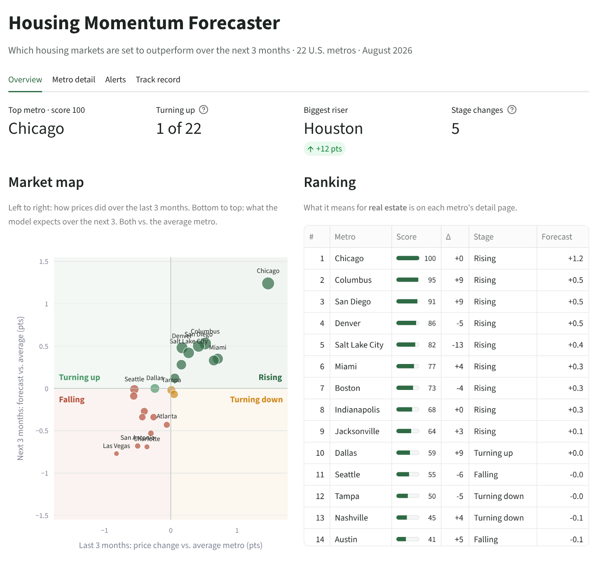
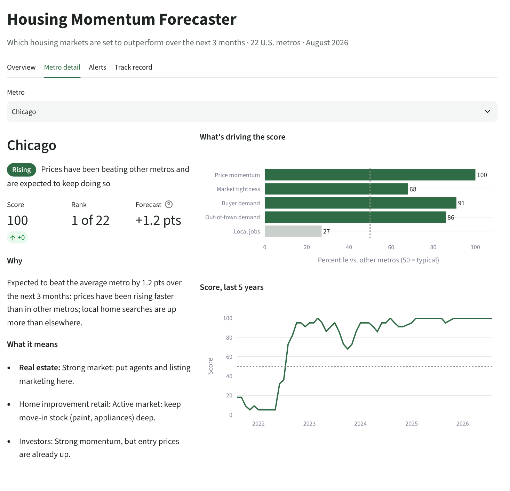
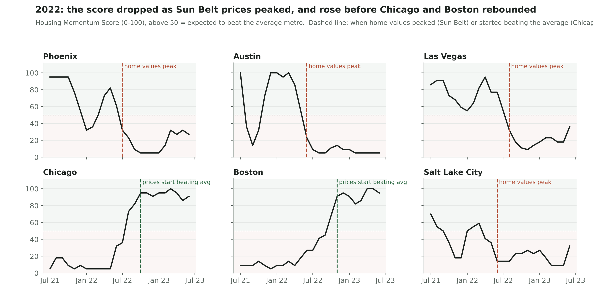
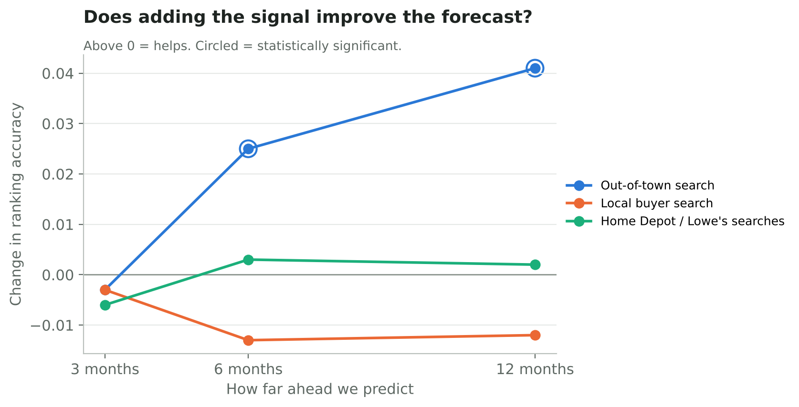

# Housing Momentum Forecaster

A monthly dashboard and index that ranks 22 U.S. housing markets by how their home prices are expected to move over the next 3 months, and explains why.

**Live dashboard:** _add your Streamlit link here_



## What it does

- **Housing Momentum Score (0-100)** for each metro, every month: the model's forecast of home-price change over the next 3 months vs. the average metro.
- **Four stages:** Rising, Turning up, Turning down, Falling. Each compares where prices have been with where they're expected to go.
- **The reason behind every call:** price momentum, market tightness (how fast homes sell, inventory, price cuts), buyer search, out-of-town search, local jobs.
- **What it means for three users:** real estate firms, home-improvement retailers and investors.



## Key findings

Tested month by month from 2020 to 2026. Every forecast used only data available at the time.

| Finding | Result |
| --- | --- |
| Beats the "trend continues" baseline | Ranking accuracy 0.87 vs. 0.73 (significant, p < 0.001) |
| Top 5 picks | 96% beat the average metro over the next 3 months |
| Score sorts markets correctly | Score 80-100: +1.14 pts vs. average next 3 months; score 0-20: -1.24 pts |
| Flags turning points early | Crossed 50 before 81% of 93 lasting price-trend turns, typically 1-2 months early |
| Does Google search help? | Not at 3 months. **Out-of-town search** (people elsewhere searching for homes in a metro) significantly improves 6- and 12-month forecasts |
| What predicts best | Price momentum and how fast homes sell |

**2022 case study:** the score dropped as Sun Belt prices peaked and rose 1-3 months before Chicago and Boston started outperforming.





**Limits:** Zillow smooths its home-value series, so price trends are partly predictable from past prices alone; the fair comparison is against the trend baseline. The biggest misses came in Austin in 2021, when prices swung faster than any recent trend suggested.

## Data (all free and public)

- [Zillow Research](https://www.zillow.com/research/data/): home values, days to pending, sale-to-list ratio, inventory, price cuts, new listings, homes sold
- [FRED](https://fred.stlouisfed.org/): 30-year mortgage rate, state unemployment, Census home-improvement store sales by state
- [BLS](https://www.bls.gov/): metro payroll jobs and unemployment
- [Google Trends](https://trends.google.com/): local home-search terms and nationwide "[city] homes for sale" searches

## Method

1. `step1_collect.py`: download all data
2. `step2_build.py`: one row per metro-month; features compared with the average metro
3. `step3_model.py`: walk-forward test of ridge regression models (housing data, + search, + home-improvement search) vs. a naive baseline, with Diebold-Mariano significance tests
4. `step4_index.py`: Housing Momentum Score, stages, reasons, track record
5. `step5_activity.py`: does search predict activity (new listings, homes sold)?
6. `step6_findings.py`: results by period, misses, turning points, 2022 case study, slide charts
7. `step7_signal_tests.py`: does each extra signal help at 3, 6 and 12 months?
8. `dashboard.py`: Streamlit dashboard

## Run it

```bash
pip install -r requirements.txt
python step1_collect.py          # about 1 hour (Google Trends is slow)
python step2_build.py && python step3_model.py && python step4_index.py
python step5_activity.py && python step6_findings.py && python step7_signal_tests.py
streamlit run dashboard.py
```

On Windows, double-click `run_all.bat`, then `run_dashboard.bat`. Try it without downloading: `python make_demo_data.py && python step2_build.py --raw data/raw_demo && python step3_model.py && python step4_index.py`.

## Team

Web Analytics, Fordham University Gabelli School of Business, Fall 2026.
